<h3><code>albertirgi@github ~ $ ./contributions.sh</code></h3>

  

<h3><code>albertirgi@github ~ $ whoami</code></h3>
<table>
  <tr>
    <td valign="top"></td>
    <td valign="top"></td>
  </tr>
</table>

 

<h3><code>albertirgi@github ~ $ ls ./links</code></h3>
<a target="_blank" rel="noreferrer" href="https://albertirgi.vercel.app"><code>portfolio</code></a> &nbsp;
<a target="_blank" rel="noreferrer" href="https://docs.google.com/document/d/1zVcH-6_4RF3EQe6pjzTqTFYs9oi31A6S2pIPfxLldDw/edit?tab=t.0"><code>resume</code></a> &nbsp;
<a href="mailto:irgialbert@gmail.com"><code>email</code></a> &nbsp;
<a target="_blank" rel="noreferrer" href="https://www.linkedin.com/in/albertirgi/"><code>linkedin</code></a> &nbsp;
<a target="_blank" rel="noreferrer" href="https://discord.com/users/440791730309300264"><code>discord</code></a>

