<!-- Every card is an animated SVG drawn by scripts/cards.py and refreshed daily by
     .github/workflows/update-cards.yml. Spacing is baked into the SVGs, so keep this block free of
     blank lines and keep each row of cards on one line with no spaces between them. -->

 
 
 
 
<picture><source media="(prefers-color-scheme: dark)" srcset="./cards/title-dark.svg" /></picture> 
 
<a href="https://github.com/albertirgi/replica"><picture><source media="(prefers-color-scheme: dark)" srcset="./cards/replica-demo-dark.gif" /></picture></a>

<a href="https://albertirgi.com">albertirgi.com</a> &nbsp;/&nbsp; <a href="https://www.linkedin.com/in/albertirgi/">linkedin</a> &nbsp;/&nbsp; <a href="https://docs.google.com/document/d/1zVcH-6_4RF3EQe6pjzTqTFYs9oi31A6S2pIPfxLldDw/edit?tab=t.0">resume</a> &nbsp;/&nbsp; <a href="mailto:irgialbert@gmail.com">email</a> &nbsp;/&nbsp; <a href="https://discord.com/users/440791730309300264">discord</a>

